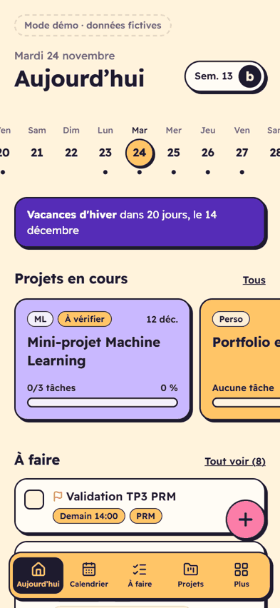

<div align="center">

# Tandhim · تنظيم

**Une app d'organisation des études, auto-hébergée, qui lit la discussion Messenger de ma filière (en darija), mes mails, Google Classroom et Drive, et en fait une seule liste de tâches et un emploi du temps fiables.**

[](https://github.com/faressjebali/tandhim/actions/workflows/ci.yml)

[English version](README.md)

**En bref** · monorepo Next.js 16 + TypeScript, SQLite, auto-hébergé sur un serveur maison de 4 Go ·
extraction par LLM de messages en darija avec **95 % de précision** sur un vrai jeu de test ·
233 tests unitaires et CI · [essayer la démo](#essayer-mode-démo) en deux commandes, sans compte



</div>

> Toutes les captures viennent du **mode démo**. Inspiré d’un vrai programme d’école d’ingénieurs ; toutes les personnes, tous les messages et toutes les tâches sont fictifs.

## Le problème

Dans ma filière d'ingénieur, les informations importantes sont éparpillées :

- une **discussion Messenger** de plus de 100 étudiants, surtout en **darija** (arabe tunisien écrit en lettres latines, mêlé de français), où une séance déplacée à mardi prochain se perd entre deux « ok merci » ;
- les **mails** des enseignants et de l'administration, sur deux comptes Google ;
- les annonces et devoirs **Google Classroom**, et des dossiers **Google Drive** partagés ;
- un **emploi du temps en semaines A et B**, un calendrier pédagogique (DS, examens, vacances) et des changements de dernière minute (séance annulée, reportée, en ligne, rattrapage, changement de salle).

Rater un message, c'est rater une validation de TP ou une deadline.

## La solution

Tandhim récupère toutes ces sources **automatiquement et en lecture seule**, une IA en extrait l'essentiel (deadlines, devoirs, changements de séance, consignes), et l'app l'affiche sur mobile comme sur PC. **Aucune validation manuelle** : tout repose sur la confiance.

- Chaque élément garde un **lien vers sa source exacte** : le mail, l'annonce ou le message précis de la discussion.
- Un badge **« à vérifier »** signale ce dont l'IA est peu sûre.
- Tout se **corrige ou se supprime en un geste**, et mes corrections ne sont **jamais écrasées** par une synchro.
- Une panne de synchro est toujours **visible** (page « État des synchros », alerte après 3 h), jamais silencieuse.

## Fonctionnalités

- **Aujourd'hui** : séances du jour (changements compris), échéances proches, projets, prochaine période d'examens.
- **Calendrier** : semaines A/B calculées depuis le calendrier pédagogique, changements de séance, séances en plus (dimanche compris).
- **À faire** : glisser à droite = terminé, à gauche = reporter, appui long = menu rapide, annulation, vue Kanban.
- **Détail d'une tâche** : quoi faire, comment rendre, consignes cumulées avec leur niveau de fiabilité, **tous les fichiers liés**, sources.
- **Projets** : projets de cours en plusieurs étapes proposés par l'IA (fusionner, renommer ou supprimer en un geste).
- **Révisions** : séances planifiées automatiquement dans les créneaux libres avant chaque épreuve.
- **Notifications** Web Push sur iPhone et PC : échéances 2 jours avant, changements de séance, nouvelles infos, pannes.
- **Recherche globale** et palette de commandes `Ctrl+K`, **hors ligne** (dernières données en cache), **ajout rapide** en langage naturel (« TP ML vendredi 14h »).

## Essayer (mode démo)

```bash
pnpm install
pnpm demo        # http://localhost:3000 : données inventées, sans compte ni mot de passe
```

Aucun `.env`, aucun compte, aucun service externe. `TANDHIM_DEMO_DATE=2026-11-24T10:05` fige l'horloge de la démo (utilisé pour les captures).

## Architecture

Une app **Next.js** (interface et API) et un **worker** Node (synchros, moteur IA, rappels, sauvegardes) partagent une base **SQLite**. Tout tourne en **Docker Compose** sur un vieux PC portable à la maison, joignable seulement par **Tailscale**. Messenger est lu à travers un pont **mautrix-meta** et un petit serveur **Matrix**. Schéma et détails : [README.md](README.md#architecture) et [docs/ARCHITECTURE.md](docs/ARCHITECTURE.md).

## Choix techniques

- **Les dates sont calculées par le code, jamais par l'IA.** Le modèle rapporte ce qui est écrit (« lkhmis jey », « ghodwa », verbe au passé…). Une fonction testée le transforme en date, en heure de Tunis.
- **Sorties JSON structurées**, validées par un schéma zod.
- **Niveaux de fiabilité** : mes corrections > écrit d'un enseignant (mail, Classroom) > Messenger. Une rumeur ne remplace jamais une consigne écrite : elle s'affiche à côté, « à vérifier ».
- **Quotas** : le niveau gratuit de Gemini impose de regrouper les messages par lots, avec reprise et backoff.
- **SQLite + Drizzle** : un seul utilisateur et un serveur de 4 Go de RAM. Un fichier est plus simple à sauvegarder qu'un serveur de base de données (sauvegarde quotidienne vérifiée, 14 jours conservés).
- **PWA** : un seul code pour l'iPhone et le PC, installable, avec notifications.
- **Auto-hébergé, réseau privé, lecture seule partout.**

## Qualité de l'extraction IA

`pnpm test:ai` : **11 cas inventés** + **21 conversations réelles** anonymisées (jamais publiées). Avec les garde-fous du code (`packages/core/src/garde-fous.ts` : un sondage ouvert n'est pas une décision, « présentiel comme d'habitude » n'est pas un changement, une date corrigée dans la discussion remplace la faute de frappe), sur trois essais : précision **95 %** en moyenne (94–95 %), rappel **87 %**. Sans ces garde-fous : 91 % et 83 % ; premiers essais du schéma enrichi : 68–81 %.

**Le compromis** : un schéma plus riche extrait beaucoup plus de chaque message (qui est concerné, si l'info remplace une consigne, comment rendre, dans quel projet), mais chaque champ en plus est une occasion d'erreur. Les erreurs restantes sont compensées par l'app :

- un lien vers la source exacte ;
- le badge « à vérifier » ;
- une correction en un geste, jamais écrasée.

Toutes les lignes portent sur les **mêmes 32 cas**, avec **Gemini Flash-Lite** (niveau gratuit). Détails dans le [README anglais](README.md#ai-extraction-quality).

## Leçons apprises

- **Un LLM ne doit pas calculer de dates.** Il rapporte ce qui est écrit, le code fait le calcul.
- **Les quotas gratuits façonnent l'architecture** : lots, choix du modèle, suivi de l'usage, replis.
- **Sans validation manuelle, tout repose sur la confiance** : source, niveau de certitude, correction instantanée, et une mesure régulière de la précision.
- **L'auto-hébergement protège les données, mais demande de l'entretien** : coupures de courant, Wi-Fi, mémoire, d'où des délais, des garde-fous et des sauvegardes vérifiées.

## Sécurité et vie privée

- Les secrets sont uniquement dans `.env` et les volumes Docker ; les jetons OAuth sont chiffrés en base.
- Mot de passe unique (scrypt), réseau privé Tailscale, accès Google en lecture seule.
- Ce dépôt public est généré depuis un dépôt privé par un script à liste d'autorisation, qui bloque la publication si une donnée réelle subsiste.

## Limites connues

Fait pour une filière et un calendrier (2026/2027), interface en français. Messenger dépend d'un pont non officiel, le quota gratuit de Gemini est limité, et l'IA n'est pas infaillible (d'où les sources et les corrections en un geste).

## Vision et feuille de route

Tandhim reste une **couche au-dessus des canaux que les étudiants utilisent déjà** (mails, Classroom, Drive, discussion de la classe) : elle ne demande jamais aux enseignants de changer leur façon de communiquer, et elle reste **gratuite**.

**Maintenant : v1, app personnelle (en finition).** Un seul étudiant, accès privé, tout ce qui est décrit plus haut. Reste : une période d'usage réel pour corriger les erreurs d'extraction, l'import de l'historique de la discussion d'avant le pont, un vrai test de restauration des sauvegardes, et l'emploi du temps du second semestre importé depuis une photo.

**Ensuite : v2, ouverte à toute ma filière (après les examens du premier semestre).**

- **Une seule app pour plusieurs filières** : inscription avec l'email de l'école, chaque classe validée par son délégué, qui configure l'espace de sa classe en quelques minutes (sources communes de l'école, une clé d'API gratuite pour l'analyse de la classe, une photo de l'emploi du temps).
- **Groupes de projet et de TP** avec des tâches partagées.
- **Sondages et inscription aux créneaux** : un sondage dont le résultat agit à sa clôture (séance en ligne ajoutée au calendrier), inscription aux validations et soutenances. La discussion de la classe reste l'espace de discussion libre et continue d'être lue.
- **Révisions personnalisées** à partir des Drives partagés des promos précédentes : les sujets qui comptent le plus, et un planning quotidien que l'étudiant ajuste.
- **Un assistant d'étude** (planifier la journée, expliquer, quiz, sujets des années précédentes) qui cite les supports de cours, ne fait jamais le travail à la place de l'étudiant, et fonctionne avec **la propre clé d'API gratuite de chaque étudiant**.

**Plus tard : v3, d'autres filières (seulement si la v2 est vraiment utilisée).** Les particularités de chaque filière (groupes, matières, enseignants, modalités de TP, vocabulaire) deviennent des données modifiables par son délégué, pas du code ; d'abord un pilote avec une ou deux filières. Un hébergement au-delà du serveur maison s'appuierait sur de vrais chiffres d'utilisation.

## Licence

[MIT](LICENSE) © 2026 Fares Jebali
