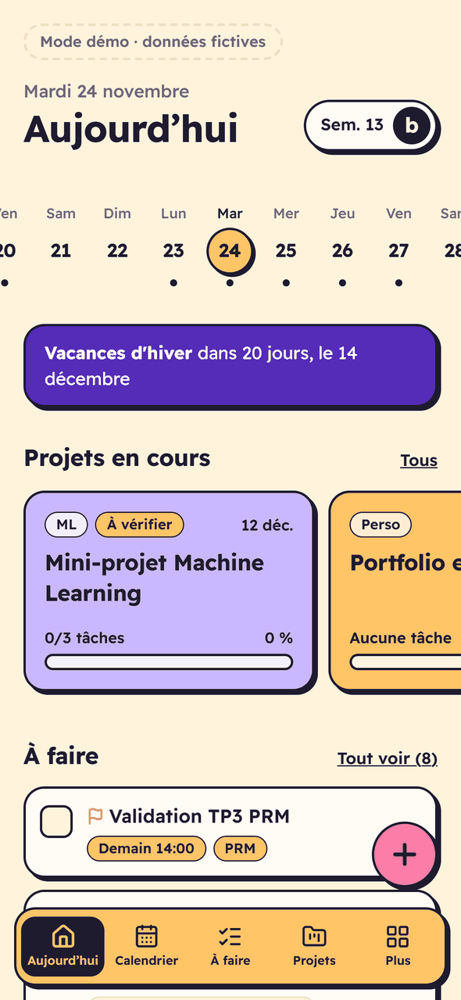
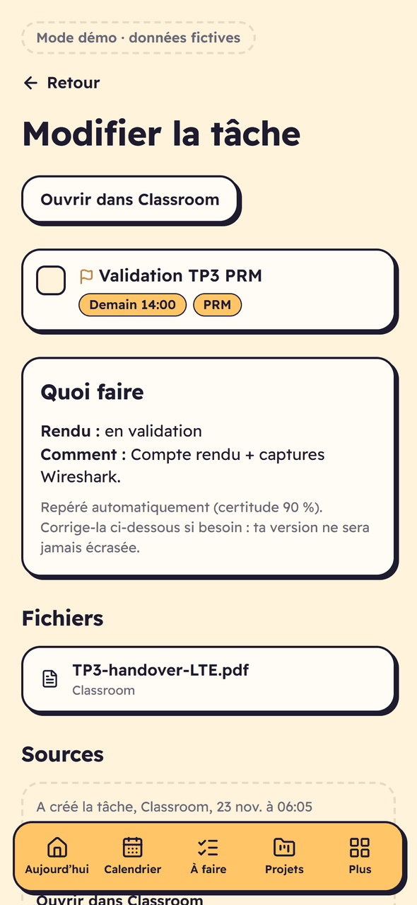
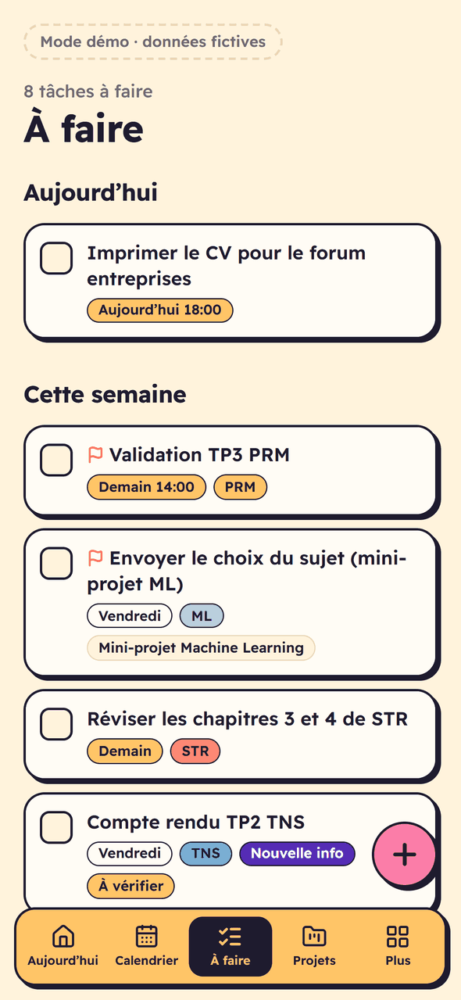
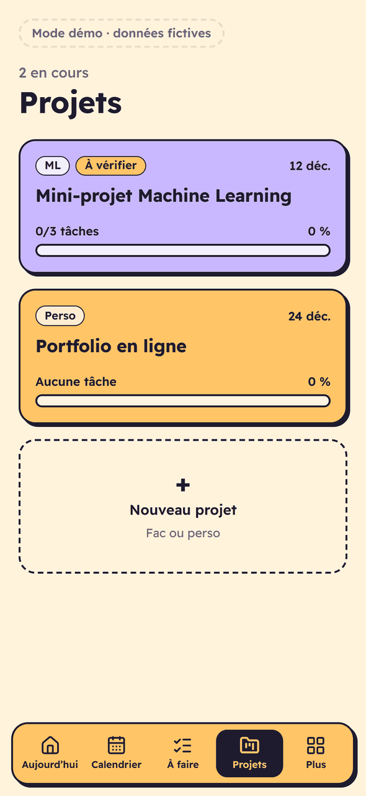
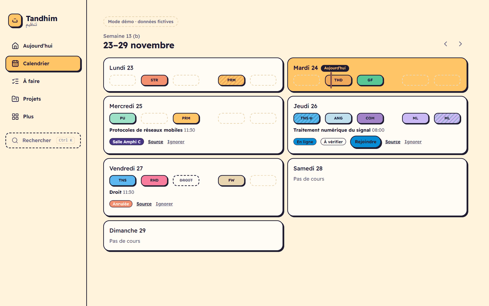
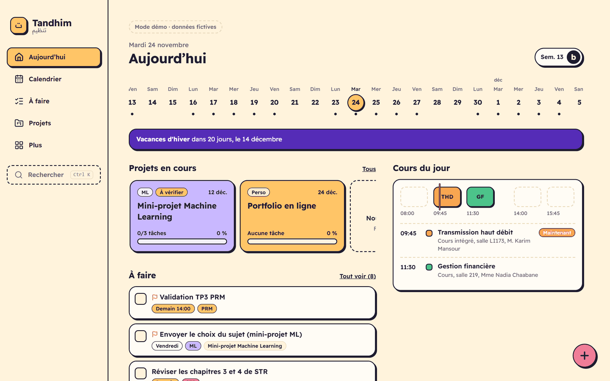
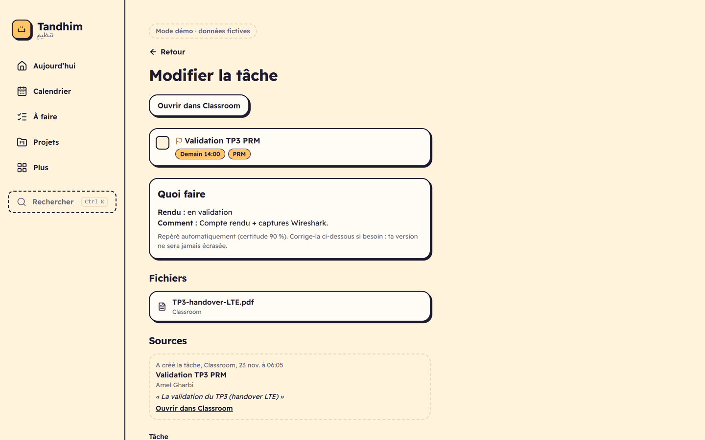
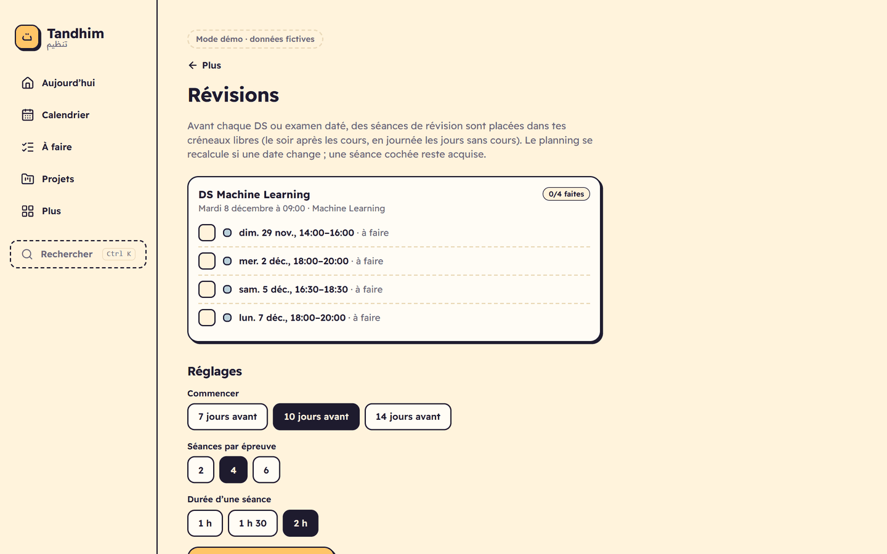
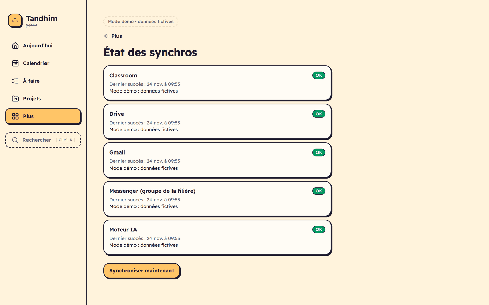
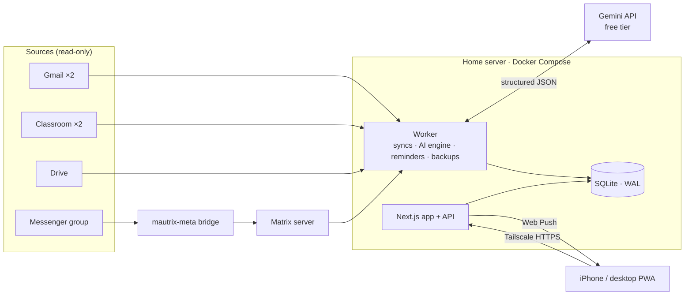

<div align="center">

# Tandhim · تنظيم

**A self-hosted study organizer that reads my class group chat (in Tunisian Darija), my emails, Google Classroom and Drive — and turns them into a single, reliable to-do list and timetable.**

[](https://github.com/faressjebali/tandhim/actions/workflows/ci.yml)


[Version française](README.fr.md)

**Highlights** · Next.js 16 + TypeScript monorepo, SQLite, self-hosted on a 4 GB home server ·
LLM extraction from Darija chat messages with **95 % precision** on a real test set ·
233 unit tests and CI · [try the demo](#try-it-demo-mode) in two commands, no account needed


</div>

> All screenshots come from the built-in **demo mode**. Inspired by a real engineering program; all people, messages and tasks are fictional.

## The problem

In my engineering program, important information is scattered everywhere:

- **a Messenger group chat** with 100+ students, written mostly in **Tunisian Darija** (Arabic written in Latin letters, mixed with French), where a session moved to next Tuesday is buried between memes and "ok merci";
- **emails** from teachers and the administration, on two Google accounts;
- **Google Classroom** announcements and assignments, and shared **Google Drive** folders;
- a **timetable that alternates between "A" and "B" weeks**, an academic calendar with exam periods and holidays, and frequent last-minute changes (cancelled, postponed, online or make-up sessions, room changes).

Missing one message means missing a lab validation or a deadline.

## The solution

Tandhim collects all of these sources **automatically and read-only**, lets an LLM extract what matters (deadlines, assignments, session changes, instructions), and shows it in a fast, mobile-first app. There is **no manual validation step**, so the design focuses on trust:

- every item keeps a **link to its exact source** (the email, the announcement, or the exact message in the chat);
- low-confidence items get an **"à vérifier" (to check) badge**;
- anything can be **corrected or deleted in one gesture**, and manual corrections are **never overwritten** by later syncs;
- every sync failure is **visible** (sync status page + push alert after 3 hours), never silent.

## Features

|                   |                                                                                                                 |
| ----------------- | --------------------------------------------------------------------------------------------------------------- |
| **Today**         | the day's sessions (with changes applied), upcoming deadlines, projects, next exam period                       |
| **Timetable**     | A/B weeks computed from the academic calendar, session changes, extra sessions (including Sundays)              |
| **To-do**         | swipe right = done, swipe left = postpone, long press = quick menu, undo, Kanban view                           |
| **Task details**  | what to do, how to submit, cumulative instructions with their reliability level, **all related files**, sources |
| **Projects**      | multi-step course projects proposed by the AI (merge / rename / delete in one gesture)                          |
| **Revisions**     | revision sessions planned automatically in free slots before each exam                                          |
| **Notifications** | Web Push on iPhone and desktop: deadlines 2 days ahead, session changes, new information, outages               |
| **Search**        | global search (tasks, subjects, messages, files) and a `Ctrl+K` command palette                                 |
| **Offline**       | last data cached by the service worker                                                                          |
| **Quick add**     | natural input: `TP ML vendredi 14h`                                                                             |

<table>
<tr>
<td></td>
<td></td>
<td></td>
<td></td>
</tr>
</table>



<details>
<summary>More desktop screenshots</summary>






</details>

## Try it (demo mode)

Requirements: Node 24 and pnpm.

```bash
pnpm install
pnpm demo        # http://localhost:3000 : invented data, no account, no password
```

The demo fills a separate database (`data/demo/`) with invented teachers, emails, chat messages and tasks, on a timetable inspired by a real program, placed around today's date. No `.env`, no account and no external service are needed. `TANDHIM_DEMO_DATE=2026-11-24T10:05` freezes the demo clock (used for the screenshots).

Other commands: `pnpm test` (unit tests), `pnpm lint`, `pnpm typecheck`, `pnpm dev` (real mode, see `.env.example`).

## Architecture



- **`apps/web`**: Next.js (App Router) UI and API routes, Tailwind CSS, PWA (manifest, service worker, Web Push compatible with iOS).
- **`apps/worker`**: separate Node process for the syncs (every 15 min), the AI engine, reminders (every 5 min), daily backups, each step guarded by a watchdog.
- **`packages/core`**: pure, tested business logic: A/B weeks, Darija relative dates, deduplication, source priorities, session changes, revision planning.
- **`packages/db`**: Drizzle schema, migrations, seed, queries, demo data.
- **`packages/ai`**: prompt, JSON schema, Darija lexicon, extraction test set.

More details in [docs/ARCHITECTURE.md](docs/ARCHITECTURE.md).

## Technical choices

- **Dates are computed by code, never by the AI.** The model only reports what is written ("lkhmis jey" = "next week's Thursday", "ghodwa" = tomorrow, past/future tense…); a tested function in `packages/core` turns it into a date with the Africa/Tunis time zone. LLMs are unreliable with calendars, and a wrong date is the worst possible bug here.
- **Structured outputs.** Gemini answers with JSON validated against a zod schema; anything invalid is retried or rejected, never guessed.
- **Source reliability levels.** My own corrections > written teacher sources (email, Classroom) > chat messages. A rumor in the chat never overrides a written instruction: it is shown next to it with "à vérifier".
- **Batching and quotas.** The free Gemini tier allows a few hundred requests per day, so sources are batched, prioritized and retried with backoff.
- **SQLite (WAL) + Drizzle.** One user, a 4 GB RAM home server: a database file is simpler, faster and easier to back up (daily, verified, 14 days kept) than a database server.
- **PWA instead of a native app.** One codebase for the iPhone and the desktop, installable, with push notifications and offline cache.
- **Self-hosted and private.** Everything runs in Docker Compose on an old laptop at home. The app is only reachable through **Tailscale** (private network, HTTPS); it is never exposed to the Internet.
- **Read-only everywhere.** The app never sends a message, replies to an email or submits an assignment.

## AI extraction quality

`pnpm test:ai` replays a test set through Gemini and compares the extracted items (date, group, subject) with the expected ones: **11 invented cases** (versioned) **+ 21 real conversations**, anonymized and never published (20 expected dated items in total).

| Version                                                             | Precision                | Recall                   |
| ------------------------------------------------------------------- | ------------------------ | ------------------------ |
| First prompt (tasks only)                                           | 100 %                    | 80 %                     |
| Richer schema, first runs (instructions, projects, session changes) | 68 % → 76 % → 81 %       | 65 – 85 %                |
| Clearer prompt, dates resolved by code (3 runs)                     | 89 – 94 % (avg 91 %)     | 80 – 90 %                |
| **+ code safeguards** (3 runs)                                      | **94 – 95 % (avg 95 %)** | **85 – 90 % (avg 87 %)** |

All rows use the **same 32 cases** and **Gemini Flash-Lite** (free tier); dates are always resolved by the same tested code.

**The trade-off.** A richer schema extracts much more from each message (who it concerns, whether it replaces an earlier instruction, how to submit, which project it belongs to), which is what makes the app useful; but every extra field is a new chance for the model to be wrong, and precision first dropped. It came back up without asking less of the model: clearer rules and examples in the prompt, all date maths in code, and a few **deterministic safeguards applied after the model** (`packages/core/src/garde-fous.ts`, unit-tested): an open poll or a question is never a decision; "the other group stays in person as usual" is not a session change; a date corrected later in the chat ("sorry, it's the 10th, I wrote 11") replaces the mistyped one; a written date that contradicts the weekday next to it is flagged "to check". The remaining errors are handled by the product, not hidden:

- every item links to **its exact source**, one tap away;
- anything uncertain gets a **"to check" badge**, and a session change known only from the chat is always marked "to check";
- a correction takes **one gesture** and is never overwritten.

What still goes wrong: an online session mentioned without a date, an exam date picked up from a side conversation, and items for the other class group that are sometimes skipped (harmless here, since that group is hidden; recall on the groups actually displayed is 86 %). Outputs vary between runs, so every change is judged on the average of several runs (`pnpm test:ai -- --essais 3`).

## Lessons learned

- **LLMs and dates don't mix.** Letting the model compute "next Thursday" produced confident, wrong dates. The model now only reports the words that were written; tested code does the calendar maths. Same idea for poll counting and merging: the model classifies, the code decides.
- **Free quotas shape the architecture.** A few hundred requests per day means batching sources, choosing the model per batch (a stronger one only for documents), tracking usage, falling back on 429 errors, and never re-analyzing what was already read.
- **No manual validation means designing for trust.** Fully automatic only works if every item shows where it comes from, how sure the model is, and can be fixed instantly without being overwritten by the next sync. Measuring precision and recall on a real test set turned "it seems fine" into numbers.
- **Self-hosting is a product feature and a chore.** A 4 GB laptop at home keeps the data private and the cost at zero, but power cuts, Wi-Fi, disk speed and memory limits are real: timeouts on every call, a watchdog per step, visible sync status, verified daily backups, and images built on the PC instead of the server.

## Security and privacy

- Secrets (OAuth tokens, API keys, password hash) live only in `.env` and Docker volumes; OAuth refresh tokens are **encrypted** (AES-256-GCM) in the database.
- Single-user app protected by a password (scrypt) and signed session cookies; private network only (Tailscale).
- Google scopes are **read-only**.
- This public repository is generated from a private one by an **allow-list script**: real data is replaced with demo data, then a scan (gitleaks + fingerprints of real messages and names) blocks the publication if anything personal remains.

## Known limitations

- Built for one student, one program and one academic calendar (2026/2027); the seed must be adapted for another school.
- Messenger has no official API: reading relies on a bridge (mautrix-meta) that can be disconnected by Meta.
- The free Gemini tier limits how many messages can be analyzed per day.
- AI precision is good but not perfect; that is why every item keeps its source and can be corrected.
- The interface and the code comments are in French (identifiers and docs are mixed French/English).

## Vision and roadmap

Tandhim stays a **layer on top of the channels students already use** (email, Classroom, Drive, the class chat): it never asks teachers to change how they communicate, and it stays **free**.

**Now: v1, a personal app (finishing).** One student, private access, everything described above. Remaining: a period of real-life use to fix extraction errors, importing the chat history from before the bridge, a real backup-restore test, and the second-semester timetable imported from a photo.

**Next: v2, open to my whole class (after the first-semester exams).**

- **One app for several programs**: sign-up with the school email address, each class validated by its representative, who sets up the class space in a few minutes (shared school sources, a free API key for the class analysis, a photo of the timetable).
- **Project and lab groups** with shared tasks.
- **Polls and slot booking**: a poll whose result acts when it closes (an online session added to the calendar), sign-up for lab validations and defenses. The class chat stays the place for free discussion and keeps being read.
- **Personalized revision** built from the shared Drives of previous years: which topics matter most, and a daily plan that the student adjusts.
- **A study assistant** (plan the day, explain, quizzes, past exams) that cites the course material, never does the work for the student, and runs on **each student's own free API key**.

**Later: v3, other programs (only if v2 is really used).** Each program's specifics (groups, subjects, teachers, lab rules, vocabulary) become data that its representative can edit, not code; a pilot with one or two programs first. Hosting beyond a home server would come with real usage numbers.

## License

[MIT](LICENSE) © 2026 Fares Jebali
